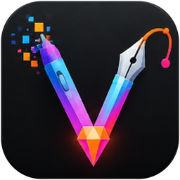

<p align="center"></p>

# Vulcanio — The all-in-one studio

*Vulcanio — Studio sáng tạo tất cả trong một*

**Phiên bản 1.2.2** · Windows 11 (x64) · Rust · Giấy phép MIT HOẶC Apache-2.0

Vulcanio gộp sáu ứng dụng sáng tạo mã nguồn mở viết bằng Rust vào **một ứng dụng, một cửa sổ**:

| Ứng dụng trong Vulcanio | Dùng để | Định dạng chính |
|---|---|---|
| Vulcanio Photo — Chỉnh sửa ảnh | Lớp, mặt nạ, cọ, bộ lọc | PSD, PNG, JPEG, WebP, TIFF… |
| Vulcanio Library — Thư viện ảnh & RAW | Nhập, sắp xếp, xử lý RAW không phá hủy | RAW (CR3, NEF, ARW, DNG…), JPEG |
| Vulcanio Vector — Minh họa vector | Đường dẫn, hình khối, chữ, gradient | SVG, PDF, AI, EPS |
| Vulcanio Layout — Dàn trang | Tạp chí, sách, trang mẫu, văn bản chạy | IDML, PDF, EPUB, Markdown |
| Vulcanio Interface — Thiết kế giao diện | Khung, thành phần, bố cục tự động, nguyên mẫu | .fig, SVG, PNG |
| Vulcanio CAD — Thiết kế kỹ thuật | Vẽ 2D chính xác, lớp, khối, kích thước, dòng lệnh | DWG, DXF |

Mỗi ứng dụng giữ **nguyên toàn bộ tính năng và giao diện** (menu, bảng điều khiển, hộp thoại,
tạo/mở/lưu/xuất tệp, phím tắt, thanh tab tài liệu…): Vulcanio chạy chính mã nguồn của ứng dụng đó
bên trong cửa sổ của mình. Nguồn gốc và giấy phép của từng thành phần: xem [NOTICE.md](NOTICE.md).

## Tính năng

- **Thanh ứng dụng** bên trái theo màu logo: Trang chủ và sáu ứng dụng; chấm cam cho biết ứng dụng
  đang chạy. Nhấp chuột phải để Mở…, Tạo mới hoặc Đóng ứng dụng.
- **Tự thu gọn**: khi đang mở một ứng dụng, thanh bên trái thu lại thành **một vạch mảnh** màu logo
  ở mép trái; đưa chuột vào vạch để thanh trượt ra. Bật/tắt bằng nút ở cuối thanh hoặc trong Cài đặt.
- **Trang chủ**: logo, khẩu hiệu, sáu thẻ ứng dụng (Mới… / Mở…), tệp gần đây, kéo-thả tệp.
- **Mở tệp đúng ứng dụng**: theo phần mở rộng; khi nhiều ứng dụng mở được (`.png`, `.svg`, `.pdf`,
  `.psd`…), Vulcanio hỏi “Mở bằng” và có thể ghi nhớ lựa chọn. Mở từ Explorer, dòng lệnh, kéo-thả,
  hoặc khi Vulcanio đang chạy (tệp được chuyển cho cửa sổ đang mở).
- **Tab tài liệu** trong từng ứng dụng: mỗi tệp mở ra là một tab trên thanh tab của ứng dụng đó.
- **Mượt như Microsoft Edge**: VSync với hai khung hình trong hàng đợi; cuộn và thu phóng bằng bánh
  xe có gia tốc êm (chỉnh thời gian trong Cài đặt); chuyển cảnh khi đổi ứng dụng; bảng điều khiển và
  thanh công cụ trượt vào khi xuất hiện; menu, chú thích và mục thu gọn có hoạt ảnh ở mọi ứng dụng.
- **Một chủ đề cho cả bộ**: Sáng / Tối / Theo hệ thống áp dụng cho Vulcanio và cả sáu ứng dụng.
- **Tiếng Anh và tiếng Việt** cho Vulcanio và các ứng dụng.
- **Tiết kiệm bộ nhớ**: ứng dụng chỉ khởi động khi dùng; ứng dụng không mở tệp nào tự đóng sau 1 phút
  chạy nền; khi Vulcanio thu nhỏ hoặc chạy nền, bộ nhớ không dùng được trả lại Windows.
- **Tăng tốc khởi động**: sau khi đăng nhập Windows, Vulcanio được chuẩn bị sẵn ở chế độ nền (đọc trước
  chương trình, nạp driver đồ họa) rồi tự thoát, nên lần mở đầu tiên sau khi bật máy nhanh. Tắt được trong Cài đặt.
- **Đóng an toàn**: khi đóng cửa sổ, từng ứng dụng đang chạy lần lượt hỏi về thay đổi chưa lưu.
- Không có liên kết cộng đồng, quảng cáo hay tự cập nhật riêng lẻ trong các ứng dụng con.

## Tải về và chạy

Bản dựng sẵn: tab **Actions** › lần chạy “Windows build” mới nhất › artifact
`Vulcanio-1.2.2-windows-x64` (gồm `Vulcanio-1.2.2-windows-x64.zip` chạy ngay, và bộ cài
`Vulcanio-Setup-1.2.2.exe` nếu có). Giải nén và chạy `vulcanio.exe`; không cần cài thêm gì.

## Dựng từ mã nguồn

Cần [Rust](https://rustup.rs) 1.95 trở lên (bộ công cụ MSVC) và Visual Studio 2022 Build Tools với
“Desktop development with C++”. Tùy chọn: [Inno Setup 6](https://jrsoftware.org/isinfo.php) để tạo bộ cài.

```powershell
git clone https://github.com/nev-minhnh/Vulcanio vulcanio
cd vulcanio
powershell -ExecutionPolicy Bypass -File packaging\windows\build.ps1   # thêm -WithFonts để nhúng phông CJK
```

Kết quả: `target\release\vulcanio.exe` và, nếu có Inno Setup, `dist\Vulcanio-Setup-1.2.2.exe`.
Bộ cài thêm Vulcanio vào “Open with” và Settings › Apps › Default apps cho 98 loại tệp.

Mỗi lần đẩy lên nhánh `main`, GitHub Actions (`.github/workflows/windows.yml`) tự dựng bản Windows.
Chạy thử khi phát triển: `cargo run -p vulcanio`.

### Dòng lệnh

```
vulcanio [--module photo|light|vector|design|fig|cad] [--new-instance] [tệp…]
```

Biến môi trường: `VULCANIO_LOG=debug` (nhật ký trong thư mục dữ liệu `Vulcanio\data\logs`),
`WGPU_BACKEND=dx12|vulkan|gl` (chọn API đồ họa), `WGPU_POWER_PREF=low|high` (chọn GPU).

## Cấu trúc mã nguồn

```
apps/vulcanio/            ứng dụng Vulcanio: thanh ứng dụng, trang chủ, định tuyến tệp, cài đặt
crates/vulcanio-host/     trait Module và kho lưu cài đặt cho từng ứng dụng
upstream/<app>/           mã nguồn sáu ứng dụng
upstream/<app>/apps/<app>-embed/
                          ứng dụng desktop của mỗi app, đổi từ chương trình thành thư viện
vendor/egui/              nhánh egui dùng chung, thêm các điểm mở rộng cho Vulcanio
packaging/windows/        build.ps1 và bộ cài Inno Setup
.github/workflows/        dựng bản Windows trên GitHub Actions
```

## Lịch sử phiên bản

- **1.2.2** — Khởi động lần đầu sau khi bật máy nhanh hơn: chỉ dùng DirectX 12 (không nạp driver Vulkan
  và OpenGL; chỉ thử chúng khi DirectX 12 không chạy được), dùng GPU mà Windows chọn thay vì luôn đánh
  thức GPU rời, và thêm **Tăng tốc khởi động** (như Microsoft Edge): sau khi đăng nhập Windows, một lần
  chạy nền ưu tiên thấp đọc sẵn Vulcanio và nạp driver đồ họa rồi thoát. Bật/tắt trong Cài đặt › Khởi động.
- **1.2.1** — Sửa lỗi cửa sổ đen khi mở ảnh trong Vulcanio Photo trên GPU thật: canvas GPU của Photo
  nay khớp bộ đệm stencil của cửa sổ (cần cho Vulcanio CAD). Lỗi đồ họa và lỗi crash được ghi vào log.
- **1.2.0** — Đổi tên thành Vulcanio, logo và khẩu hiệu mới; thanh ứng dụng theo màu logo, để lại vạch
  mảnh khi thu gọn; hộp thoại Cài đặt / Giới thiệu có nút đóng (×) và luôn dùng giao diện Vulcanio;
  cỡ chữ thanh ứng dụng; bảng điều khiển trượt vào và hoạt ảnh đồng nhất ở mọi ứng dụng; gỡ liên kết
  cộng đồng và kiểm tra cập nhật còn sót.
- **1.1.0** — Giảm bộ nhớ, thanh ứng dụng tự ẩn, một chủ đề cho cả bộ, bỏ tên và logo gốc, bỏ Discord.
- **1.0.0** — Bản đầu tiên.

## Giấy phép

Vulcanio được phát hành theo **MIT** ([LICENSE-MIT](LICENSE-MIT)) **hoặc Apache-2.0**
([LICENSE-APACHE](LICENSE-APACHE)), tùy bạn chọn — giống các ứng dụng mà nó chứa. Ghi công và các
thay đổi: [NOTICE.md](NOTICE.md).

---

## English

**Vulcanio — The all-in-one studio** (v1.2.2) puts six open-source Rust creative apps (photo
editing, a RAW photo library, vector illustration, page layout, interface design and CAD) in one
Windows 11 app and window. Every app keeps all of its features, its own interface and its document
tabs. Vulcanio adds an app bar in the logo's colours that tucks into a thin line while you work, a
home screen, file routing with an Open With chooser, one theme for every app, Edge-like smoothness
(vsync pacing, eased wheel scrolling and zooming, transitions, panels that slide in), English and
Vietnamese, memory saving for apps in the background, a single instance that receives files from
Explorer, and an unsaved-work check across apps on close.

Build on Windows: `powershell -ExecutionPolicy Bypass -File packaging\windows\build.ps1`
(Rust 1.95+, MSVC build tools; Inno Setup 6 for the installer). GitHub Actions builds the Windows
release on every push to `main`.

License: MIT OR Apache-2.0, at your option. See [LICENSE-MIT](LICENSE-MIT),
[LICENSE-APACHE](LICENSE-APACHE) and [NOTICE.md](NOTICE.md).
